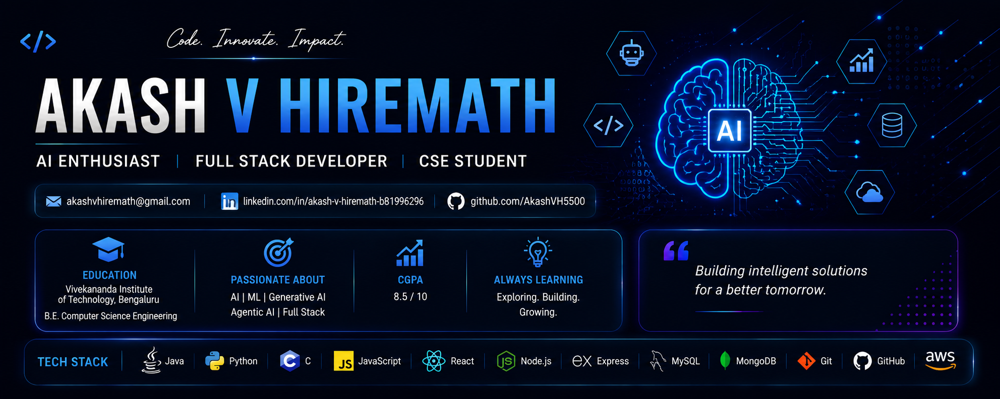

# Akash V Hiremath

### Software Engineering | Backend Systems | AI Applications

Bengaluru, India · Expected graduation: August 2027

[Email](mailto:akashvhiremath@gmail.com) · [LinkedIn](https://www.linkedin.com/in/akash-v-hiremath-b81996296/) · [GitHub](https://github.com/AkashVH5500)

---

## About

I am a B.E. Computer Science and Engineering student at Vivekananda Institute of Technology, Bengaluru, affiliated with Visvesvaraya Technological University (VTU).

- **CGPA:** 7.84/10.00 through Semester VI
- **Focus:** backend engineering, distributed systems, AI-enabled applications and applied machine learning
- **Experience:** IT development internship and IBM SkillsBuild Data Analytics with AI internship

I enjoy building software that connects APIs, data, services and practical workflows. My repositories include distributed application prototypes, deterministic data-processing tools, AI workflow experiments and applied analytics.

## Technical Toolkit

| Area | Technologies |
| --- | --- |
| Languages | Java, Python, JavaScript, Kotlin, C++, C, SQL |
| Backend | FastAPI, Flask, Node.js, REST APIs |
| Data and ML | Pandas, NumPy, scikit-learn, XGBoost, SHAP, Jupyter |
| Databases and messaging | MySQL, PostgreSQL, Redis, RabbitMQ |
| Tools and infrastructure | Git, GitHub, Docker, Maven, Google Cloud / Vertex AI |

## Selected Projects

### 1. Distributed Malware Detection Platform
[Repository](https://github.com/AkashVH5500/malware-detection-platform)

A distributed file-analysis prototype with seven backend services, a React dashboard, RabbitMQ messaging, PostgreSQL, Redis and Docker Compose. It demonstrates static metadata analysis, feature aggregation, ML inference and concurrent workers. The dynamic-analysis stage is simulated; this project does not execute untrusted files in a real sandbox. The included training script can generate synthetic data, so its metrics are not evidence of real-world malware-detection performance.

### 2. Ghost Data Audit Agent
[Repository](https://github.com/AkashVH5500/ghost-data-audit-agent)

A deterministic Python workflow that reconstructs data-deletion state from structured evidence such as logs, SQL snapshots, ledgers and metadata. It produces findings, remediation actions and verification steps. The final runtime uses no language model; the repository documents evaluation results and known limitations.

### 3. U.S. Data Science Job Market & Skills Analytics
[Repository](https://github.com/AkashVH5500/global-job-market-skills-analytics)

An analytics project completed during the IBM SkillsBuild Data Analytics with AI internship. It analyses 742 raw Glassdoor postings and 467 cleaned U.S. data-science postings from 2020 using data cleaning, exploratory analysis, statistical testing, visualisation and a salary-prediction experiment. Results are scoped to that historical U.S.-only dataset.

### 4. AI Personal Learning Assistant
[Repository](https://github.com/AkashVH5500/ai-learning-assistant)

A capstone prototype exploring a planner, PDF retrieval, summarisation, quiz generation and optional Google Cloud Storage-backed memory. The current repository documents which components are rule-based, extractive or placeholders; it should not be mistaken for a fully LLM-driven production tutor.

### 5. College Assistant Chatbot
[Repository](https://github.com/AkashVH5500/ai-college-chatbot)

A FastAPI and Streamlit application that retrieves relevant college FAQs with embeddings and uses Gemini to compose responses from the retrieved context.

## Research and Leadership

- **Breast Cancer Detection with SHAP Explainability:** team lead for a four-member undergraduate project involving machine-learning classification and model explainability; the associated research paper has been published.
- **NSS Volunteer, VIT Bengaluru:** community outreach and plantation activities.
- **Campus 2 Community Fellow, Yuvaka Sangha:** completed a 100-hour fellowship.

## Professional Development

- Anthropic — Model Context Protocol: Advanced Topics
- Google / Kaggle — 5-Day AI Agents Intensive Course
- NPTEL — Data Science for Engineers
- Google — Automate Cybersecurity Tasks with Python
- Skyscanner — Software Engineering Job Simulation (Forage)

## Problem Solving

[LeetCode](https://leetcode.com/) · 100+ problems solved

---

I am interested in software engineering opportunities where I can contribute to backend systems, practical AI applications, data-intensive workflows and reliable software.
